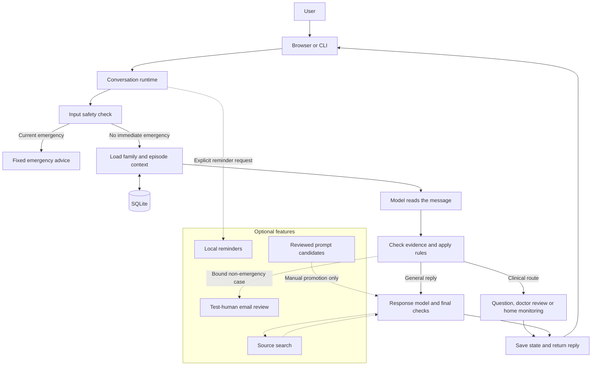

# How the app works

The model helps understand and answer messages. Code checks what it says, keeps each person's records separate and decides which safety route applies. No model output can override the fixed emergency response.

## High-level design



Solid arrows show the main path. Dashed arrows show extra features. The diagram is a map, not a promise that every message uses every step: greetings, family setup, reminders and cache hits can take shorter paths.

The doctor-review route returns the assignment's fixed transfer wording **with a demo disclaimer**. It does not contact a clinician. Optional email goes only through the separately enabled test-review workflow.

## Low-level design: one turn

```mermaid
sequenceDiagram
    actor User
    participant HTTP as server.Handler
    participant Run as Runtime
    participant Store as Agent / SQLite
    participant Model as Model client
    participant Rules as Agent._advance
    participant Search as Search adapter
    User->>HTTP: POST /api/chat
    HTTP->>Run: chat(household, message, request_id)
    Run->>Run: Check current emergency wording first
    alt Current emergency
        Run->>Store: Save scoped emergency hold
        Run-->>HTTP: Fixed emergency advice, no model wait
    else Safe shortcut: greeting or family setup
        Run->>Store: Save turn; keep any earlier concern
        Run-->>HTTP: Short reply, with context note when needed
    else Model interpretation needed
        Run->>Store: Read allowed members, episodes and saved facts
        Run->>Model: Intake prompt + bounded context + JSON schema
        Model-->>Run: IDs, intent, facts and quoted evidence
        Run->>Run: Check schema, identity and supporting text
        alt Model reports a supported emergency
            Run->>Store: Save emergency hold
            Run-->>HTTP: Fixed emergency advice
        else Continue assessment
            Run->>Rules: Validated update and saved state
            Rules-->>Run: Route, missing fields and reasons
            alt Fixed clinical outcome
                Run->>Store: Save state and turn
                Run-->>HTTP: Question, review or home-monitoring text
            else General answer or profile wording
                opt Valid education-cache hit
                    Run->>Run: Reuse checked response; still run intake and safety
                end
                loop Until valid final reply or call limit, on a cache miss
                    Run->>Model: Response prompt + checked context + available sources
                    Model-->>Run: Final JSON or web_search call
                    opt Allowed search call
                        Run->>Search: De-identified query
                        Search-->>Run: Source text and status
                        Run->>Run: Add tool result to model context
                    end
                end
                Run->>Run: Check response, citations and action claims
                Run->>Store: Save state and turn
                Run-->>HTTP: Checked reply or safe error
            end
        end
    end
    HTTP->>Store: Save visible messages and safe metadata
    HTTP-->>User: Complete JSON response
```

The response loop defaults to four model calls and two tool calls per turn. It can stop early. A tool error, invalid response or exhausted limit produces a safe failure; it does not trigger an unlimited retry. Only `web_search` is model-callable today. Email, reminders and memory writes are not model permissions.

## Where to look in code

| Part | File | Job |
|---|---|---|
| HTTP and session handling | `server.py` | Local routes, household cookie, settings and chat history |
| Turn flow and prompts | `runtime.py` | Intake, validation, bounded response/search loop and final checks |
| State and triage | `health_agent.py` | Member/episode updates, fixed outcomes and SQLite writes |
| Memory | `continuity.py`, `memory_context.py`, `memory_queries.py` | Sourced facts, corrections, relevant context and safe recall |
| Next question | `question_selection.py` | Choose an allowed missing field; check warning signs first |
| Model connections | `model_client.py`, `provider_adapter.py`, `openrouter_client.py` | Provider requests, route checks and usage limits |
| Search and citations | `retrieval.py` | Read source content and check the quoted support |
| Optional features | `reminders.py`, `human_review.py`, `gmail_worker.py`, `learning.py` | Separate reminder, review and evaluation workflows |

SQLite's `households` table stores members, episodes, sourced facts and recent turns inside a state record, with a revision for write conflicts. `chat_messages` stores the browser-visible history. Optional workflows have their own tables. The model sees only the permitted context; it does not query arbitrary households or access credentials.

Memory means retaining and retrieving reported facts. Prompt improvement is a different process: reviewed synthetic examples, DSPy, unseen evaluation cases, safety checks and manual promotion. The completed experiment showed no gain, so no optimized prompt is active.
